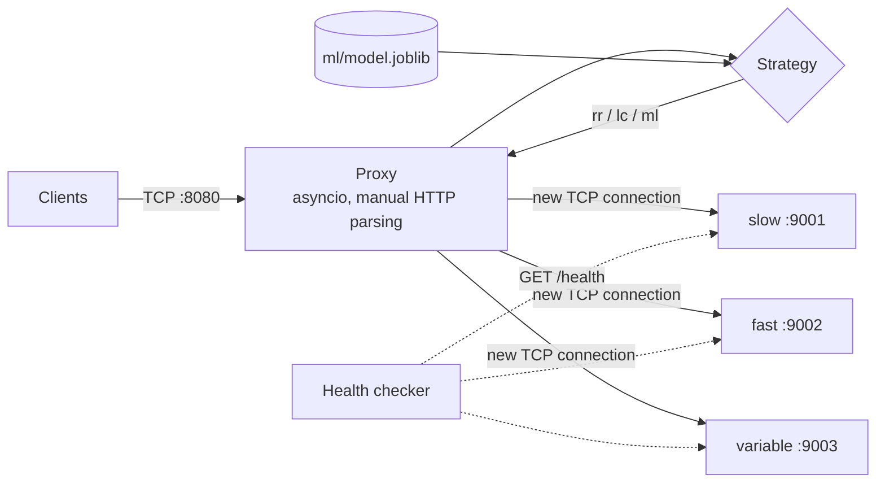

# ML-Based Adaptive Load Balancer

A layer-7 HTTP load balancer built from scratch on raw `asyncio` TCP sockets (no nginx, no proxy libraries), with a pluggable strategy interface and a machine-learning strategy that predicts per-backend response time and routes each request to the fastest backend.

Built as a Computer Networks project to combine low-level networking with applied ML.

## Features

- **Raw-socket reverse proxy**: accepts client TCP connections, parses HTTP requests by hand, opens a new TCP connection to a backend, relays the response.
- **Timeouts and retry**: header, connect and read timeouts; a failed backend triggers a retry on another one; `502` if none is available.
- **Active health checks**: periodic `GET /health` marks backends UP/DOWN and brings recovered ones back.
- **Three strategies behind one interface**: round-robin, least-connections, and ML-based.
- **ML strategy**: gradient boosting regressor predicts response time from live backend state; epsilon-greedy exploration; automatic fallback to least-connections if the model is missing or fails.
- **Reproducible evaluation**: data collection, training script, async load generator and a benchmark with three scenarios (steady, burst, mid-test slowdown), producing CSVs and charts.

## Architecture



The three backends are simulated HTTP servers with different artificial delays: `slow` (~0.5 s), `fast` (~0.1 s) and `variable` (0.2 to 0.8 s random). Delays can be changed at runtime via `/set_delay`, which is what makes the slowdown scenario possible.

## Results

Mean of 3 repetitions per scenario and strategy, all on one machine over loopback. Full numbers are in `results/summary.csv`.

| Scenario | Strategy | Avg (ms) | p95 (ms) | p99 (ms) | Throughput (req/s) |
|---|---|---|---|---|---|
| steady | round-robin | 373 | 723 | 788 | 50.9 |
| steady | least-connections | 229 | 605 | 754 | 79.7 |
| steady | **ML** | **200** | 616 | **685** | **88.5** |
| burst (high load) | round-robin | 379 | 737 | 795 | 92.4 |
| burst (high load) | least-connections | 238 | 607 | 750 | 136.7 |
| burst (high load) | **ML** | **135** | **145** | **511** | **215.2** |
| after slowdown | round-robin | 605 | 820 | 826 | 31.8 |
| after slowdown | least-connections | 572 | 819 | 827 | 33.8 |
| after slowdown | **ML** | **535** | 817 | 828 | 36.2 |

Share of requests sent to the `fast` backend before and after it slowed down from 0.1 s to 0.8 s:

| Strategy | Before | After |
|---|---|---|
| round-robin | 33.5% | 33.2% |
| least-connections | 69.0% | 21.5% |
| ML | 70.3% | 7.4% |

Charts: `results/metrics_by_phase.png`, `results/slowdown_over_time.png`, `results/distribution_after_slowdown.png`.

**Read these results with care.** The ML strategy ties or beats least-connections in this setup, but the model relies almost entirely on recent latency (see [REPORT.md](REPORT.md) for the honest analysis and limitations).

## Quick start

Requires Python 3.10+. Run every command from the project root, each long-running one in its own terminal.

```bash
pip install -r requirements.txt
```

**Terminal 1: start the three backends**

```bash
python start_backends.py
```

**Terminal 2: start the proxy** (`rr`, `lc`, `ml` or `random`)

```bash
python -m load_balancer.proxy --strategy rr
```

**Terminal 3: send traffic**

```bash
python load_generator.py --requests 100 --concurrency 20
```

On Windows PowerShell use `curl.exe` (not `curl`) to inspect which backend answered:

```powershell
1..10 | ForEach-Object { curl.exe -s -i http://127.0.0.1:8080/ | Select-String "X-Backend" }
```

### Reproduce the ML pipeline

```bash
# 1. Proxy in data-collection mode (random routing, logs features + latency)
python -m load_balancer.proxy --strategy random --log-data
# 2. In another terminal: run varied loads and backend speeds
python collect_data.py
# 3. Train the model (writes ml/model.joblib)
python train_model.py
# 4. Run the proxy with the trained model
python -m load_balancer.proxy --strategy ml
```

### Reproduce the benchmark

Keep only the backends running (stop any proxy; the script starts and stops proxies itself):

```bash
python benchmark.py
```

Takes several minutes and writes `results/raw.csv`, `results/summary.csv` and the charts.

### Try failover

Stop one backend (or start only `python -m backends.fast_backend 9002`) while the proxy runs. The proxy logs `[health] ... is now DOWN`, retries on the remaining backends, and brings the backend back when `/health` succeeds again.

## Project structure

```
backends/
  base_backend.py      shared raw-socket HTTP server (/, /health, /set_delay)
  slow_backend.py      ~0.5 s delay
  fast_backend.py      ~0.1 s delay
  variable_backend.py  0.2-0.8 s random delay
load_balancer/
  proxy.py             reverse proxy, HTTP parsing, retry, health checks, data logging
  strategies.py        Strategy interface, round-robin, least-connections, random, ML
start_backends.py      launches the three backends
load_generator.py      async load generator
collect_data.py        varied scenarios for training data
train_model.py         trains and evaluates the regressor
benchmark.py           steady / burst / slowdown benchmark + charts
ml/                    training data and trained model
results/               benchmark output (CSV + PNG)
```

## Limitations

- Backends are simulated and asynchronous, with no CPU or connection capacity limit. ML routing about 97% of traffic to one backend is harmless here but could overload a real server.
- Everything runs on one machine over loopback, so there is no real network latency or packet loss.
- The proxy speaks HTTP/1.1 with `Connection: close` (one request per connection) and does not support keep-alive, TLS, chunked request bodies or WebSockets.
- Not production software; see [REPORT.md](REPORT.md) for details.

## Tech stack

Python, `asyncio`, raw TCP sockets, scikit-learn, pandas, matplotlib.